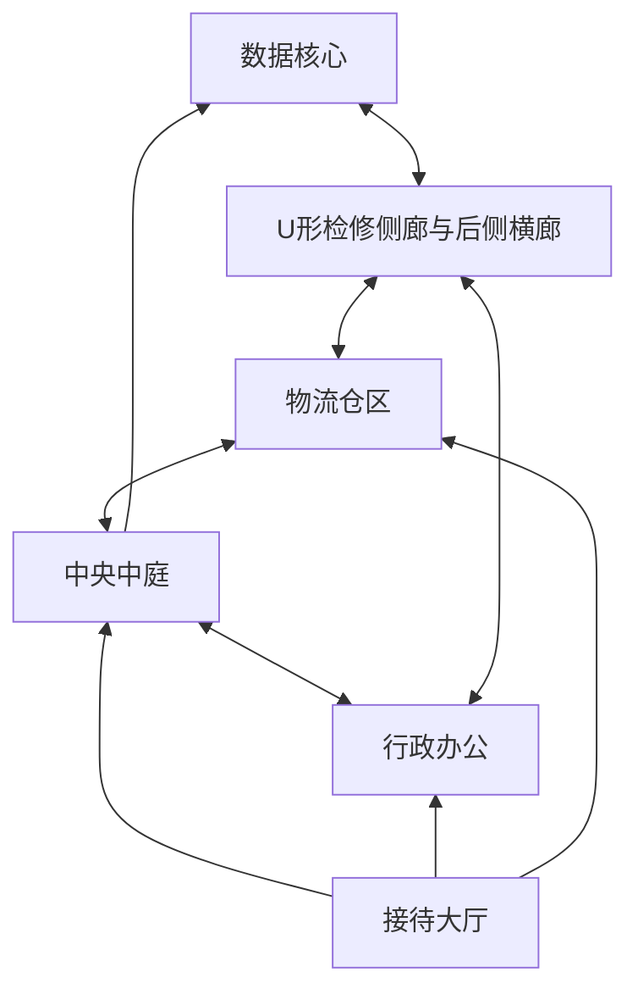

# A01 扩大地图与光影：Editor走图指南

本轮验证空间、路线和光影。四个机器人只有岗位展示和原模型Idle；地面黄线仅为未来巡逻示意。凭证、发现/追逐、任务目标和Echo伙伴LLM尚未接入，当前没有胜负或要搬运的物品。

## 打开与操作

打开 `Assets/EchoStation/InfiltrationLevel/Scenes/ES_Infiltration_Routes.unity`。按Play，点击Game捕获鼠标。WASD走路，鼠标转头，空格跳跃，Esc释放鼠标，点击Game重新捕获；Tab隐藏/显示路线线条。测试后退出Play即可，无需保存Play中的改动。

独立样板在Play时使用IL专用Forward/HDR管线，退出时还原进入前绑定。Unity6000.6.7f1、D3D11；只使用内部HDR转SDR，不开启Windows显示器HDR。旧A00、回收/解谜版场景和构建保留。

## 建议走图顺序（约3–5分钟，不是完整潜入流程）

1. 出生在接待大厅。先原地向左右看，找正面蓝线、左侧橙线、右侧青线三个入口，观察层高是否仍压抑。
2. 沿蓝线穿过检查门框进入6m高的中庭，再往前到数据核心。检查门岗与路口能否辨认。
3. 返回中庭，向左进入行政办公。桌椅/终端形成遮挡；可往前进西侧检修，也可换回中庭，验证路线并非单向走廊。
4. 沿检修走到最北侧横廊，透过观察窗看核心，再绕到东侧检修和物流仓区。大箱体提供视线遮挡，从物流侧门回到接待大厅。
5. 按Tab隐藏辅助线，再试从行政或物流侧找到核心与返回大厅的路。观察暖色办公、冷色仓区、中庭薄光雾、观察窗暗部和标牌可读性。

36×32m包络、六功能区，常规顶高4.5m、中庭6m。扣除墙体/设备投影后的可探索地面保守下界约1021.7m²，为旧96m²样板的约10.6倍；门框空跨亦被保守扣除，不把包络面积或NavMesh面积冒充净面积。

## 本次反馈重点

请优先判断：规模与层高是否合适；三路和回环是否能看懂；遮挡/观察点是否适合未来潜入；光照是否过暗/过白/雾太重。指出“在哪个区、朝哪边、什么问题”即可。路线文字里的凭证/员工权限只是预留设计，不代表现已实现。

技术效果为PBR、方向性烘焙GI/光照探针、SSAO、区域离线反射、有限主光阴影单次散射薄雾及ACES调色。不是UE5/Lumen，SSR/SSS未实现。本机Editor表现不能证明最低/推荐目标机达标；实际工程/性能/保护结果见[A01-C报告](E:/Projects/Unity/EchoStation/Docs/Tests/InfiltrationPrototype/Reports/A01-C_Editor_TestReport.md)。

完成本轮走图反馈前，停止在A01，不自动进入A02守卫行为、A03潜入闭环或A04 Echo LLM。
