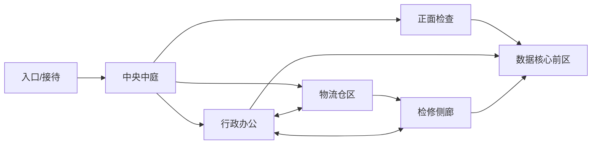

# A00反馈02：潜入地图、守卫岗位与光影提案

后续确认：用户2026-11-01已采用Q1面积/布局、Q2四守卫/先地图后行为、Q3 Unity/性能优先全部建议；下面“待确认”为提案历史。当前仅执行A01，边界与独立门禁见A01_ExecutionPlan.md，完成后本人Editor走图再决定后续。

日期2026-11-01；状态：研究/提案，待Q1–Q3确认，尚未修改场景、资产、渲染配置或行为。用户四点原话保留在Docs/Tests/InfiltrationPrototype/Evidence/A00/Editor_UserFeedback_B.json。A00视觉需修改，原工程Final_E16/16仍仅是旧样板的工程结果。

## 1. 已明确的方向和需要确认的规格

用户希望地图至少为当前9倍、允许不同路线，借鉴经典潜行地图；考虑多守卫、定点守门与巡逻分工；材质不强求，光影需要明显提升，所列效果不能实现时允许不强求。当前小样板不能作为完整潜入关卡，不再以“样板间里加几个物体”回答这一诉求。

“9倍”未说明面积还是边长。建议按实际可探索地面面积：旧A00地面约8×12=96m²，新地图净可探索地面≥864m²；建议建筑包络36×32=1152m²，为墙体/封闭设备区留空间。不能仅用包络面积证明达标；区域地面平面并集扣除墙体与不可达封闭空间，另记NavMesh面积，二者不混用。若用户意指每条边9倍，必须重做范围，不按此提案静默解释。

建议继续第一人称科幻设施、复用现有免费真实模型，首扩图单层，常规房间4.5m、中央空间可局部6m；不增加攀爬/钻管道/翻越/电梯所需新操作。36×32是待确认规格，不是实测结果。

## 2. 参考依据及本项目应用

- [IO Interactive《HITMAN》官方玩法介绍](https://ioi.dk/hitman/game-features)：潜行、伪装和环境机会支持不同接近办法。本项目据此提出同一目标的不同权限/风险路线，不照搬其战斗、击倒、武器或NPC规模。
- [IO Interactive设计师Mette Podenphant Andersen的GDC讲座](https://www.gdcvault.com/play/1025879)：将关卡作为社会空间分析。这里用于提出公共/员工/受限区的明确门槛与守卫岗位；本轮阅读公开简介，没有宣称看完录像或审阅全部幻灯。
- [Arkane关卡总监Christophe Carrier对《Dishonored 2》机械宅邸的第一手说明](https://www.gamedeveloper.com/design/level-design-deep-dive-i-dishonored-2-s-i-clockwork-mansion)：后台空间与大空间的视觉联系、功能可信的房间有助于玩家建立地图认知。本项目据此设计可隔窗观察的侧路线、功能分区与回环，不做机械变形房间或超能力。

以上是设计原则的借鉴，下面的布局与数量是本项目建议，并非上述作品的原地图复刻。

## 3. 建议布局：六功能区、三主路线、两个回环

| 区域 | 空间与后续玩法作用 | 视觉区分 |
| --- | --- | --- |
| 入口/接待 | 安全观察起点、将来撤离点 | 清晰白蓝标识、可见下一空间 |
| 中央中庭 | 路线选择、观察守卫与通道 | 局部高顶、主光与少量暖色点缀 |
| 行政办公 | 将来凭证/身份线索与正门路线 | 桌椅、终端、规则明确的员工边界 |
| 物流仓区 | 掩体、巡逻视线交替、隐蔽路线 | 实际货箱/设备模型和侧向光 |
| 检修侧廊 | 较长绕行、交叉观察与退路 | 窄一些但不低矮、少量局部薄雾 |
| 数据/安保核心 | 三路汇合前的第二次选择 | 更明确的门岗、冷暖重点照明 |

三条路线提案：正面公共→凭证检查；行政侧→员工权限路径；物流/检修侧→观察巡逻并利用遮挡。不同代价是未来玩法设计目标，A01只提供可走空间/预留门槛和标注，不用文字标签冒充已经实现的证件/潜行机制。

O–W–M形成可换线回环；入口–中庭–行政–物流的连接再形成一处撤回/重新观察回环，落地时必须有实际连通边，不能只有示意图中的箭头。至少两个安全观察点、三处明确遮挡节点与一处能看见目标区的观察窗口；避免长直走廊把全图暴露在同一条视线上。不得把“面积变大”本身当趣味性验收。

## 4. 守卫建议与短任务顺序

建议首版共4个机器人，复用同一已校验免费动画模型：入口检查岗1、核心固定岗1、中央/行政巡逻1、物流/检修巡逻1。使用岗位标识/配色区别，不新增真人面部、口型、制服换装美术。四个均采用传统行为树；Echo仍为独立LLM语义＋传统执行伙伴，模型不能接管门卫。

建议仍一次一项：

| 短任务 | 交付范围 | 结束门禁 |
| --- | --- | --- |
| A01 扩图与路线美术样板 | 三路/双回环的独立真实模型场景、基础光影、四岗位摆位/巡逻路线可视化 | 本人走图、评估规模/路线辨识/遮挡与画面；停下 |
| A02 门卫传统行为树 | 定点守卫与两条实际巡逻，之后细分感知/调查/返回 | 各细分模块独立测试，交本人测试；具体感知/失败规则在该任务前确认 |
| A03 无LLM潜入闭环 | 凭证/权限、目标拿取、撤离、发现后的处理 | 具体道具/伪装表达/失败与重试需先定稿；脚本可通关 |
| A04 Echo伙伴短任务 | 问候、现场观察、约定/改口与可见协作逐项验证 | 新权限/契约与有界模型实验先确认，旧No-Go不自动解除 |

A01的四岗位只展示机器人及清楚标注的路线；不宣称已有巡逻AI。A02并未获本轮实施授权，不能把确认地图规格扩成连续完成全部阶段。原有权限不自动扩大至Echo开门、改机关、替玩家完成任务。

## 5. 渲染效果的具体处理

现有引擎Unity6000.6.7f1、URP17.6.0、普通Forward、D3D11、内部HDR/SDR。UE5是另一引擎，不是Unity渲染开关；建议以用户所述的电影光影为视觉参考，保留Unity求职定位，不承诺达到未定义的“3A画质”。不迁移HDRP/UE5、不升级包或更改全局编译宏。

| 用户期望 | 本项目建议 | 判定方式/限制 |
| --- | --- | --- |
| PBR、HDR | 保留URP Lit的合理粗糙度/金属度、法线与内部HDR/ACES | 实际Shader/参数与Game图；不等于显示器HDR |
| 全局光照、自然间接光、颜色溢色 | 静态烘焙间接光＋动态对象光照探针 | 实际Lightmap/探针和有无间接贡献的对照；不是实时Lumen/动态全场GI |
| AO | 使用当前已编译的SSAO，适量补接触层次 | 深度/法线、边缘光晕及开销对照；不以压黑全图制造层次 |
| 体积光 | 对2–3个重点窗口/灯位做有预算的局部散射验证 | 真实深度遮挡/移动视角验证；现有16步局部雾是候选，不假称完整带阴影体积系统 |
| 空气透视 | 室内局部薄雾/有限距离层次 | 不做全图浓雾、不遮掉路线/守卫轮廓，不宣称物理大气散射 |
| SSR反射 | 第一轮使用烘焙反射探针；SSR列后续独立可行性门禁 | 当前包有SSR源码但受URP_SCREEN_SPACE_REFLECTION保护，实际packages反射搜索0个类型；有源码≠已可用。探针不是SSR，现阶段不报SSR完成 |
| 次表面散射SSS | 首轮省略 | 金属机器人/设施受益小，URP无内置同等SSS；自制透光近似不能当完整SSS |
| 电影光影/更好看 | 主次光、暖冷对比、轮廓/接触层次、可读暗部与节制调色 | 固定视角前后对照＋本人实机判断，不以特效数量替代视觉验收 |

基础工程在Unity支持范围内可以实施，成效与开销仍要实际验证。已有NextLocalFog是半分辨率16步、最多3盒/4灯的简化散射，当前代码未逐采样查询灯光阴影，不能直接声称其已满足墙体挡光的完整体积光需求；必要改进单独测试，失败时关闭该效果并说明。

来源：[Unity6.6功能对照](https://docs.unity.com/en-us/engine/6000.6/manual/render-pipelines/choose-a-render-pipeline/feature-comparison)、[Unity官方SSR预览说明](https://discussions.unity.com/t/preview-of-screen-space-reflections-for-urp/1721494/1)。官方功能表仍将URP SSR标No，而本机包包含条件编译的预览代码，故以本机只读反射结果和后续实际门禁区分，不概括成“URP永远不能SSR”。源码路径与0/1类型读回保存在Feedback02_RenderReadback.json；没有运行渲染测试或开启功能。

性能基线继续最低i5-8400/GTX1060 6GB/16GB，1080p中画质60FPS；推荐i5-12400/RTX3060 6GB/16GB，1080p高画质60FPS。高/中/低可裁剪AO/体积与阴影，当前开发机不代替目标机达标证明。最近资源测量19.764430/20GiB是A00历史交付值；新增地图先复用已有网格/贴图、独立新Lightmap和必要派生数据，20GiB不变，不擅删旧资源腾空间。

## 6. A01建议细分和独立用例（计划，未执行）

| 子模块 | 用例与可执行门禁 |
| --- | --- |
| A01-A 空间/连通 | 自有场景/旧版保护；有效地面≥864m²；三个不同分支各可由入口走到目标前区；两个实际回环、门洞净空、无出界/穿墙；数据/导航与实际控制器走通分账 |
| A01-B 模型/岗位/导向 | 主要建筑/门卫/道具实际模型来源、米制比例；四岗位唯一标记、两条路线可视化；走图看见三个入口且有遮挡，不以Gizmo或路径点冒充巡逻行为 |
| A01-C 光影/漫游交付 | 实际烘焙/探针/HDR/SDR/普通Forward、SSAO/反射/薄雾分别验证开关与图像；真实输入/碰撞/光标；截图和本机Profiler分账；完整设置还原/旧SHA/Console/20GiB，再交本人Editor测试并停止 |

A01内部逐模块独立通过并归档才进入依赖项，统一Tools/MCP/module_tests.py；烘焙在具名自有Single场景外置驱动，沿用F-338，不保存/丢弃用户未保存内容。只在干净且非用户播放会话时操作，不打包；需要重启仍仅在确认无未保存内容的旧授权边界内。

## 7. 待确认三项

Q1：是否按面积而非边长，采用36×32m包络、净可探索≥864m²、六区三路线双回环的方案？

Q2：是否首版规划4个机器人（2定点＋2巡逻），下一短任务先A01地图/岗位与路线预览，交本人测试后再另做A02真实行为树？

Q3：是否保留Unity普通URP/既定硬件60FPS，以烘焙GI/PBR/内部HDR/SSAO/反射探针/局部光雾与调色为首轮目标；SSR/SSS非硬门槛，UE5/3A只作光影参考，不迁移引擎？确认范围内的普通摆放/材质/灯光/路径细节由代理记录后实施，产品、权限、预算或硬约束改变仍确认。

在Q1–Q3答复前不启动A01工程、守卫行为或新模型实验。本轮完成的是第一手资料研究、现有包/只读API核验和提案，不是地图、AI或新渲染效果交付。
