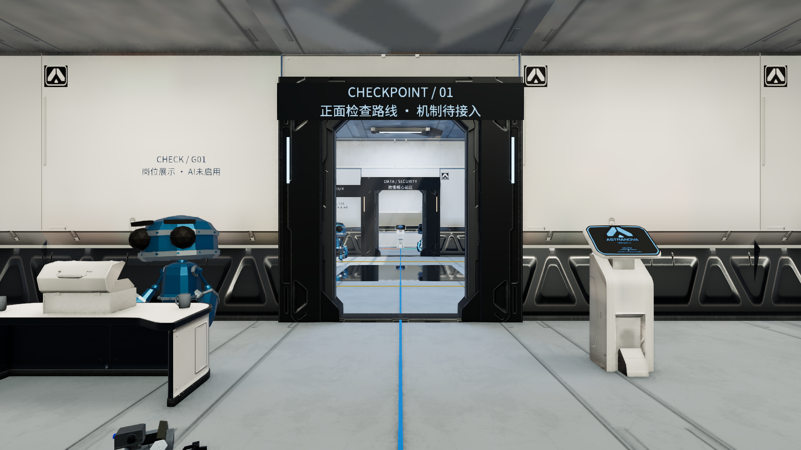

# EchoEcho / EchoStation

Unity 6000.6.7f1 · Windows x64 · URP Forward · 内部HDR / SDR · D3D11。

当前主线是**3D第一人称科幻设施伪装潜入原型**。本轮完成全场浅灰半哑光涂层、保留结构金属、重烘焙GI与区域反射。当前可漫游六区/三路线/双回环；四守卫仍仅岗位和Idle展示，真实检查/巡逻、任务闭环和潜入场景Echo LLM尚未接入。

接手开发先读 **[HANDOFF.md](HANDOFF.md)**，再读[AGENTS.md](AGENTS.md)、[开发总文档](Docs/DevelopmentPlan.md)和[故障经验](Docs/Troubleshooting.md)。

## 打开与体验

用指定Unity版本打开仓库根目录，等待UPM/资产导入，然后打开：

`Assets/EchoStation/InfiltrationCoated/Scenes/ES_Infiltration_Coated.unity`

按Play、点击Game。WASD/鼠标移动观察，Space跳跃，Esc释放鼠标；Tab切换路线，F8切换中庭局部地面倒影。见[Editor走图指南](Docs/InfiltrationPrototype/A01F_EditorPlayGuide.md)。本轮没有新Windows打包，历史Builds不在Git。

## 真实验证与限制

F01材质/布局21/21，F02光照/雾/反射11/11，F03输入/动画/采样3/3；最终受影响组合25/25，无跳过。新场景有自己的2张Lightmap、216光照探针、8区域反射和一块1024宽平面反射，非硬件光追/SSR。旧场景、模型、存档、构建和完整历史证据保留原机。

[实际F01报告](Docs/Tests/InfiltrationPrototype/Reports/A01-F01_CoatingAssets_TestReport.md) · [实际F02报告](Docs/Tests/InfiltrationPrototype/Reports/A01-F02_Lighting_TestReport.md) · [实际F03报告与性能限制](Docs/Tests/InfiltrationPrototype/Reports/A01-F03_Editor_TestReport.md)。

**尚未达到60FPS性能验收。**本轮开发机Editor的涂层版和旧金属控制均测到较高帧时；采样有效不等于达标，原因与优化仍待独立Profiler任务。最低GTX1060/推荐RTX3060目标机、新机完整Unity导入和真人潜入流程均未验收。

## 仓库包含什么

包含C#、Unity素材及.meta、主场景/烘焙输出、Packages/ProjectSettings、工具、开发/模块报告和精选本轮实图。Library/Temp、私有连接配置、旧发行包、原始Profiler、原包和约1.8GiB模型权重留本机，不进入Git；因此不是原工作目录的逐字节全量备份。

当前主场景不依赖模型权重。恢复旧AI实验见[重建与模型说明](Docs/Repository/RebuildAndModels.md)；默认脚本，旧Qwen3诊断质量仍No-Go，不把只读实验入口当可靠伙伴AI。主线计划是传统BT守卫＋LLM/BT Echo伙伴，下一短任务的具体规则需先确认。

资源与源码来源见[第三方通知](Docs/Repository/ThirdPartyNotices.md)。仓库未给项目自有代码新增统一开源许可证；第三方许可分别保留。

## 历史原型

旧五区解谜、回收/环境工具版本均保留在Assets与Docs供参考，不是当前主场景或已授权待办。[原环境回收README](Docs/Archive/README_EnvironmentalSalvage.md)保留历史玩法与按键；其中指向Builds/完整Evidence的链接在精简Git克隆中可能不可用。
